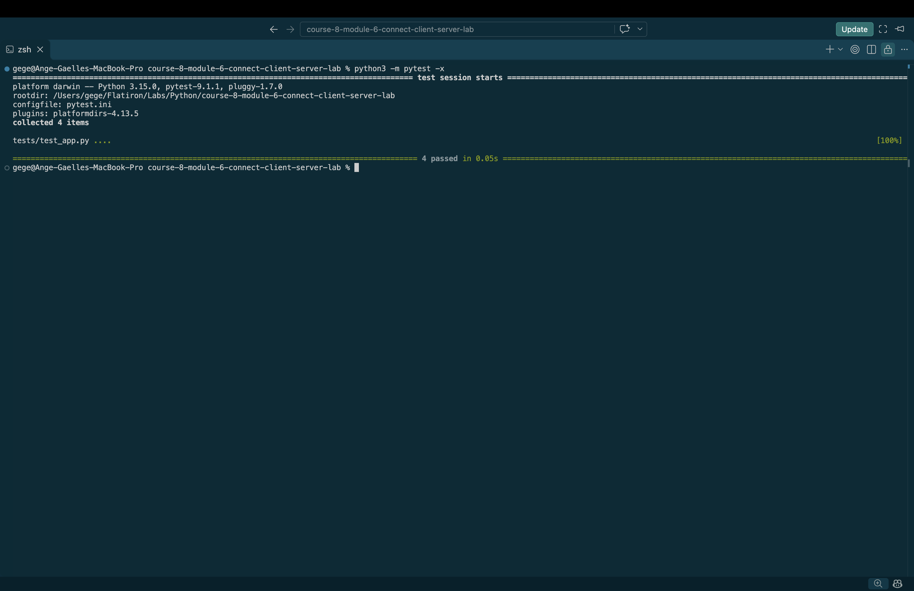

# Client-Server Application: Event Catalog

## Description

This project is a simple Event Catalog application built using Flask, Python, HTML, and JavaScript.

The application demonstrates communication between a front-end client and a back-end RESTful API.

Users can view existing events and submit new events through a web form without refreshing the page.

## Technologies Used

- Python 3
- Flask
- Flask-CORS
- JavaScript
- HTML
- Fetch API
- JSON

## Features

- Display a welcome message through a Flask API.
- Retrieve events from the server using GET requests.
- Display events dynamically on the webpage.
- Create new events using a form.
- Send event data to Flask using POST requests.
- Validate event titles.
- Display newly created events without refreshing.
- Handle HTTP errors and unsuccessful requests.

## Project Structure

The main application files are:

- `server.py` — Flask back-end server.
- `client/index.html` — Front-end HTML page.
- `client/script.js` — JavaScript for API communication and DOM updates.

## API Endpoints

### GET /

Returns a JSON welcome message.

Example response:
```bash
  {
    "message": "Welcome!"
  }
```

HTTP status: `200 OK`

### GET /events

Returns all events as a JSON array.

Example response:
```bash
  [
    {
      "id": 1,
      "title": "Yoga in the Park"
    },
    {
      "id": 2,
      "title": "Lake 5K Run"
    }
  ]
```

HTTP status: `200 OK`

### POST /events

Creates a new event.

Example request body:
```bash
  {
    "title": "Python Workshop"
  }
```

Example response:
```bash
  {
    "id": 3,
    "title": "Python Workshop"
  }
```

HTTP status: `201 Created`

If the title is missing or invalid, the server returns `400 Bad Request`.

## How to Run the Application

### 1. Clone the Repository

```bash
  git clone git@github.com:a-gbatie/course-8-module-6-connect-client-server-lab.git
  cd course-8-module-6-connect-client-server-lab.git
```
### 2. Install Dependencies

Install Flask and Flask-CORS in your Python environment:
```bash
  python3 -m pip install flask flask-cors
```

### 3. Start the Flask Server

Run:
```bash
  python3 server.py
```

The server runs at:

http://127.0.0.1:5000

### 4. Open the Front End

Open `client/index.html` using the Live Server extension in VS Code.

The webpage will typically be available at:

http://127.0.0.1:5500/client/index.html

The exact address depends on your Live Server configuration.

## How the Application Works

### Retrieving Events

When the webpage loads, JavaScript uses `fetch()` to send a GET request to the Flask API.

Flask returns a JSON array containing the events.

JavaScript converts the JSON response into objects and uses DOM manipulation to display each event as a list item.

### Creating Events

When the user submits the form:

1. JavaScript prevents the default page refresh.
2. The event title is read from the input field.
3. The title is validated.
4. A POST request sends the title to Flask as JSON.
5. Flask creates a new event with a unique ID.
6. Flask returns the created event with HTTP 201.
7. JavaScript adds the event to the displayed list.
8. The input field is cleared.

## Testing

The application can be tested manually by:

- Opening the homepage API endpoint.
- Retrieving the events list.
- Creating an event through the form.
- Verifying that the new event appears immediately.
- Submitting an empty title to test validation.
- Checking the browser console for errors.

Run Automated Tests:
```bash
  python3 -m pytest -x
```

## Screenshot of Completed Tests
